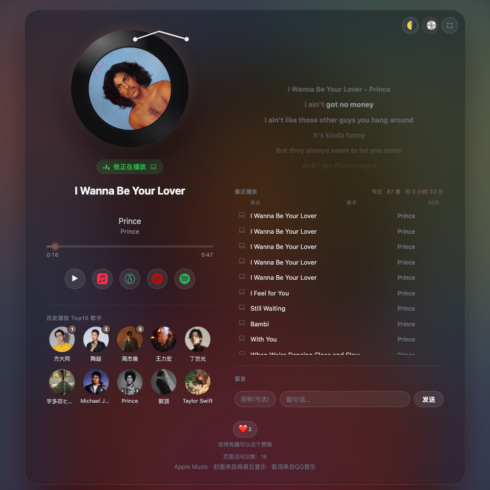

<div align="center">

# nowplaying-workers

**The Cloudflare Workers behind a shareable, live "now playing" page for Apple Music — a state relay on Workers KV, plus a live README badge.**

**Language / 语言:** **English** | [简体中文](README.zh-CN.md)


[**See it live →**](https://yudaotor.github.io/nowplaying/?user=yudaotor)

</div>

## What's in this repo

| Module | What it does |
|---|---|
| [`state-worker/`](state-worker) | The main relay: receives pushed now-playing state (`POST /push`), serves it to the web page (`GET /now`, `/history`, `/top-artists`), and backs the visitor features (guestbook, reactions, visitor counter) on Workers KV — with per-IP rate limiting, plus a daily write budget so visitor traffic can't eat into the KV free tier's daily write quota |
| [`badge-worker/`](badge-worker) | Renders the relay's data as a live-updating SVG badge you can embed in any README |

(There's also [`worker/`](worker) — a legacy 302 redirect left over from a retired personal Feishu-signature integration, kept alive only because old links still point at it. Almost certainly not what you came for.)

## How it fits together

```
Lyrimuse's Mac collector
  └─ POST /push (on every track change / pause / periodic heartbeat) ──▶ your state-worker (this repo, Cloudflare Worker + KV)
                                                                               │
                                                                               ├─ GET /now, /history, /top-artists, and other read-only endpoints
                                                                               │        ↓
                                                                               └──▶ your web page (Yudaotor/nowplaying) ── falls back to ListenBrainz if the relay is unreachable
```

| Repo | Role |
|---|---|
| [**Yudaotor/nowplaying**](https://github.com/Yudaotor/nowplaying) | The web page itself, plus a fork-ready template (`demo/`) |
| **Yudaotor/nowplaying-workers** (this repo) | The relay and badge behind it |
| **Lyrimuse** | The macOS menu-bar lyrics app whose collector pushes live state (not yet open-source — see [Prerequisite](#prerequisite)) |

- The collector has no idea whether the web page or the Worker even exist — it just unconditionally pushes state to whatever address is configured. If state-worker is down or was never deployed, the collector carries on exactly as before; the local floating lyrics are unaffected.
- The web page prefers reading from your own state-worker; if state-worker itself is unreachable (or you simply never deployed one), the page automatically falls back to reading straight from ListenBrainz — in that mode you still get "now playing" and history, but the guestbook, reactions, visitor counter, and top-10-artists modules (all of which need to write to KV) won't appear, since they have no ListenBrainz fallback path.
- The collector side needs exactly one piece of configuration: `state_relay_url` + `state_relay_token` (the "Sync Server URL" + "Access Token" fields on the "Web Push" card in Lyrimuse's Settings). Fill in both and the whole chain starts running — there is no separate switch to flip.

## What it powers



A live now-playing card with word-synced lyrics, playback history, a guestbook, reactions, a visitor counter, and a top-artists leaderboard — the full tour with more screenshots is in the [web page's own README](https://github.com/Yudaotor/nowplaying#readme), and the screenshot above is the author's actual live page, [yudaotor.github.io/nowplaying](https://yudaotor.github.io/nowplaying/?user=yudaotor), not staged data.

## Deploy your own

### Prerequisite

The live-push side of this chain — the Lyrimuse macOS app and its collector — **isn't open-source yet**. That's less of a blocker than it sounds:

- Everything in this repo, plus the web page, deploys and runs fine without it: the page falls back to reading ListenBrainz directly, so if your listens already reach ListenBrainz some other way (any scrobbler works), "now playing" and history light up immediately.
- The guestbook, reactions, and visitor counter are driven entirely by your page's visitors — no collector involved at all.
- What the collector adds once it ships: instant track-change updates, playback progress (which is what enables synced lyrics on the page), resolved cover art, and the daily top-artists push.

### Step 1: Deploy your own state-worker

`state-worker/` is a Cloudflare Worker (the free tier is plenty: 1,000 KV writes / 100,000 reads per day) — the collector pushes current state to it, and the web page reads from it. If you already have one set up, you can skip straight to `cd state-worker && npm run deploy` to publish code changes. To set one up from scratch:

1. Sign up for a Cloudflare account.
2. (Optional) Move DNS hosting for the domain you want to use to this Cloudflare account — only needed if you want a custom domain; without your own domain, you can use a Cloudflare-assigned `*.workers.dev` subdomain instead and skip this and sub-step 5.
3. `npx wrangler login` to authorize the CLI against this account.
4. Create a KV namespace: `npx wrangler kv namespace create NP_STATE`, and put the returned `id` into `state-worker/wrangler.toml`'s `[[kv_namespaces]]`.
5. Change `wrangler.toml`'s `[[routes]]` to your own domain (`custom_domain = true` binds it automatically on first `deploy`, provided sub-step 2's DNS hosting has already taken effect).
6. Change `[vars]`'s `LB_USER` and `WEB_PAGE_URL` to your own ListenBrainz username and your own page URL (you'll have that after "Step 2: Deploy your own web page" below).
7. Set two secrets (values are never committed to the repo):
   ```bash
   cd state-worker
   npx wrangler secret put PUSH_TOKEN   # authenticates the collector — any random string works
   npx wrangler secret put ADMIN_TOKEN  # lets the site owner manually delete guestbook entries — best kept different from PUSH_TOKEN
   ```
8. `npm run deploy`.

By the end of this step, you'll have:
- A reachable state-worker address (a custom domain or a `*.workers.dev` subdomain)
- A `PUSH_TOKEN` you generated yourself (used to authenticate the collector)

### Step 2: Deploy your own web page

The page lives in its own repo, [Yudaotor/nowplaying](https://github.com/Yudaotor/nowplaying). Start from its [`demo/`](https://github.com/Yudaotor/nowplaying/tree/main/demo) folder — that's the fork-ready template: no personal relay address or social metadata baked in, and its `RELAY` constant defaults to empty (= direct ListenBrainz).

```bash
git clone https://github.com/Yudaotor/nowplaying.git web-page
# Copy web-page/demo/index.html into your own repo and host it on any static site
# (GitHub Pages / Cloudflare Pages both work). Visit it at:
# https://<your-domain>/index.html?user=<your ListenBrainz username>
```

Then point it at the state-worker from step 1 — either way works:

- **No source edits**: pass `?relay=<your address>` on the URL (for example, `?user=xxx&relay=https://your-worker.workers.dev` when sharing a link).
- **Make it the default**: edit the `RELAY` constant near the top of the template's `<script>` block so visitors don't need the parameter.

(The `index.html` at that repo's root is the author's own live deployment of the same page — identical features, but with the author's relay address baked in. To skip the relay entirely on any copy, pass `?relay=off`.)

### Step 3: Connect Lyrimuse to state-worker

Open Lyrimuse's menu bar "Settings…" → sidebar "Add-on Features" → "Web Push," and fill in two fields:

- **Sync Server URL**: the state-worker address from step 1
- **Access Token**: the exact same string as the `PUSH_TOKEN` from step 1

That's it — there's no separate switch to go find and turn on. The next time the collector restarts (which happens automatically after saving settings), it starts pushing state to this address.

### Step 4: Verify it

1. Visit your own web page address directly and check whether you can see "now playing" or "last played" (rather than getting stuck on "connecting…").
2. Switch tracks, wait a few seconds, and refresh — confirm the title/cover art actually changed. That confirms the collector → state-worker → web page chain is genuinely connected, rather than the page silently reading the ListenBrainz fallback (in fallback mode, there's usually a much longer delay between switching tracks on your Mac and seeing it reflected on the page, and modules like the guestbook won't show up at all).
3. Try leaving a message or clicking the like button on the page, then refresh and confirm it's still there.

### Optional: A GitHub README Badge (badge-worker)

Requires the state-worker above to already be running. `badge-worker/` is another optional Cloudflare Worker that reads state-worker's data and renders it as a live-updating SVG badge:

1. Change `RELAY_URL` in `badge-worker/wrangler.toml`'s `[vars]` to your own state-worker's address.
2. `cd badge-worker && npm run deploy`.
3. Embed it in any README: ``.

## What This Can't Do / Current Limitations

- **The five optional display modules (history / guestbook / reactions / visitor counter / top-10-artists) have no per-module toggles**: as soon as "Web Push"'s address + token are configured, all five appear together; leave them blank and none of the five appear. If you genuinely only want some of these modules, the only way to do that right now is to edit your copy of the page (`index.html`) and delete the DOM/initialization code for the ones you don't want.
- **The "recent playback history" module is only available through ListenBrainz**: state-worker keeps no listen history of its own (its KV holds the current state, the visitor-interaction records, the daily top-artists snapshot, and a small module-visibility config — but no per-listen log), so even if you want nothing to do with ListenBrainz and only use state-worker to push "now playing," the history list on the web page still comes from falling back to ListenBrainz directly.
- **Connecting to ListenBrainz directly from within China can be unreliable.** That's the whole reason state-worker (a "China-accelerated relay") exists in the first place — you don't have to deploy it, but without it the page may occasionally spin/stall when accessed from within China.
- **The web page (`index.html` in Yudaotor/nowplaying) and `state-worker/src/index.js` each maintain their own, nearly-identical copy of the `fromLB` "parse raw ListenBrainz data" function**, and both have comments pointing at the other file. This is because they're deployed on two unrelated platforms — GitHub Pages and Cloudflare Workers — with no shared build step that would let them actually share source code. If you need to change that parsing logic, you have to change it in both places, or the two will silently drift out of sync.

## Troubleshooting

**The page is stuck on "Connecting… will retry automatically"** — Check whether the URL has the right `?user=` parameter (your ListenBrainz username), and whether your browser can actually reach your state-worker address (or whether ListenBrainz itself is reachable).

**Track changes take forever to show up, and modules like the guestbook / top-10-artists are missing** — This means the page is currently running on the ListenBrainz fallback path, not genuinely connected to your state-worker. Check: whether Lyrimuse Settings' "Web Push" address + token are filled in and saved (saving triggers an automatic collector restart to pick it up); whether the page's URL accidentally has `?relay=off` on it; and try visiting `https://<your-state-worker-address>/now` directly in a browser to confirm it returns normal JSON (not a 401 or 500).

**`/push` keeps returning 401** — `state_relay_token` (the one you entered in Lyrimuse's settings) and state-worker's `PUSH_TOKEN` (the one set via `wrangler secret put`) must be the exact same string. The most common cause is changing one side and forgetting the other.

**Cover art / artist avatars won't load** — Cover art comes from NetEase's image hosting; top-10-artist avatars come from QQ Music's image hosting, falling back to Deezer. Depending on where you're browsing from, any of these can occasionally fail to load. The page has a fallback for both cases (cover art falls back to a solid-color background, avatars fall back to a circular-initial placeholder), and nothing else on the page is affected.

**I only want the "now playing" display, not the guestbook and other interactive features** — There's currently no way to enable "some but not all" of these — see "What This Can't Do" above. You'd need to edit your copy of `index.html` and remove the modules you don't want.
